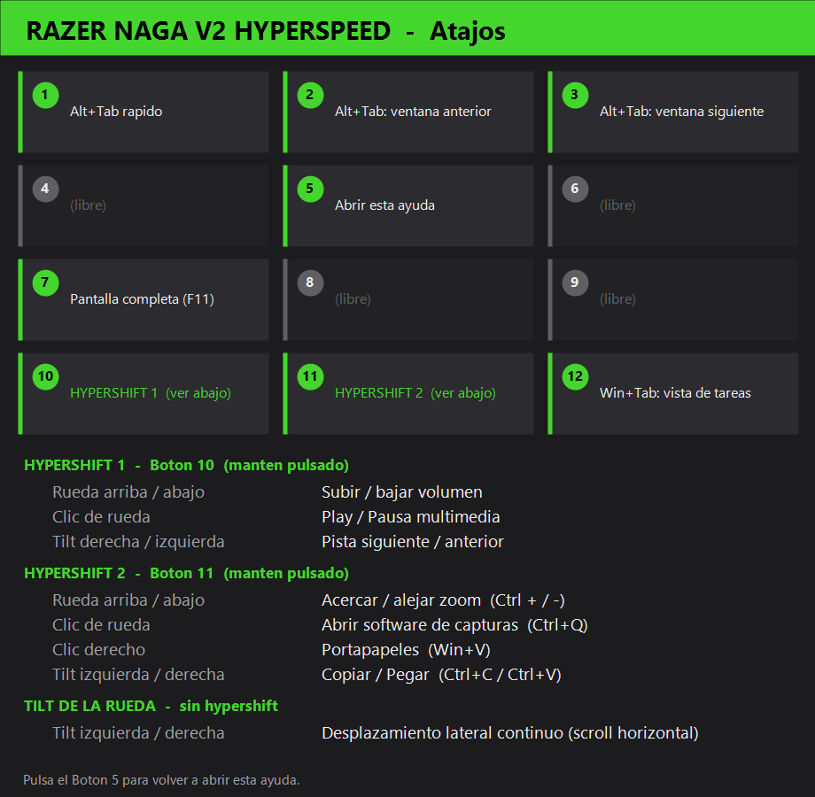

# Razer Naga V2 Hyperspeed — Macros (Windows + Linux)

Macros para los **12 botones laterales** del ratón Razer Naga V2 Hyperspeed,
con dos modos **Hypershift**, un selector **Alt+Tab persistente** y soporte
para el **tilt** de la rueda.

El mismo conjunto de atajos está implementado en dos versiones equivalentes,
cada una en su carpeta:

| Sistema | Carpeta | Tecnología |
|---------|---------|------------|
| **Windows** | [`windows/`](windows/) | Python + `ctypes` |
| **Linux** (Wayland/X11) | [`linux/`](linux/) | Python + `evdev`/`uinput` |

```
├── windows/
│   ├── instalar.bat             ← doble clic: instala la app (menú Inicio, escritorio, autoarranque)
│   ├── naga_macros_win.py       el demonio de macros
│   ├── NagaV2_Macros_Win.vbs    lanzador (doble clic, sin consola)
│   └── NagaV2_atajos.png        guía de atajos (la muestra el Botón 5)
├── linux/
│   ├── instalar.sh              ← instala la app (servicio + lanzador en el menú)
│   ├── naga_macros.py
│   └── NagaV2_atajos.png
├── generar_guia_atajos.py   ← regenera la imagen en windows/ y linux/
├── generar_icono.py         ← regenera el icono de la app
└── CHANGELOG.md             ← versión e historial de cambios
```

**Instalación rápida:** en Windows, doble clic en `windows/instalar.bat`; en
Linux, `linux/instalar.sh`. Aparece la app **Naga V2 Macros** (icono verde con
una «N») en el menú Inicio / de aplicaciones: abrirla arranca las macros, y si
se colgaron, las reinicia.

> La imagen está repetida a propósito en cada carpeta: el **Botón 5** la abre
> con una ruta relativa al script.

---

## Cómo está montado el ratón

Los 12 botones laterales **no** ejecutan las macros por sí mismos: en
**Razer Synapse** se configuraron para enviar las teclas **F13 → F24**, y
estos scripts "capturan" esas teclas y ejecutan la acción correspondiente.

> La asignación F13–F24 conviene **guardarla en la memoria interna del ratón**
> (perfil *onboard*). Así también funciona en Linux, donde Synapse no existe.

Correspondencia botón → tecla:

| Botón | Tecla | | Botón | Tecla |
|:----:|:----:|:--:|:----:|:----:|
| 1 | F13 | | 7  | F19 |
| 2 | F14 | | 8  | F20 |
| 3 | F15 | | 9  | F21 |
| 4 | F16 | | 10 | F22 |
| 5 | F17 | | 11 | F23 |
| 6 | F18 | | 12 | F24 |

---

## Mapa de atajos



### Botones simples

| Botón | Acción |
|:----:|--------|
| **1** | Alt+Tab rápido (un toque) |
| **2** | Selector Alt+Tab persistente — ventana **anterior** |
| **3** | Selector Alt+Tab persistente — ventana **siguiente** |
| **4** | Siguiente pestaña (`Ctrl+Tab`) |
| **5** | Guía de atajos — visible **mientras se mantiene** pulsado (overlay) |
| **6** | *(libre)* |
| **7** | Pantalla completa (`F11`) |
| **8** | *(libre)* |
| **9** | *(libre)* |
| **12** | Vista de tareas — `Win+Tab` (Windows) / Actividades-Super (Linux) |

### Hypershift 1 — Botón 10 (mantener pulsado)

| Combinación | Acción |
|-------------|--------|
| Rueda arriba / abajo | Subir / bajar volumen |
| Clic de rueda | Play / Pausa multimedia |
| Tilt derecha / izquierda | Pista siguiente / anterior |

### Hypershift 2 — Botón 11 (mantener pulsado)

| Combinación | Acción |
|-------------|--------|
| Rueda arriba / abajo | Acercar / alejar zoom (`Ctrl +` / `Ctrl -`) |
| Clic de rueda | `Ctrl+Q` (abrir software de capturas) |
| Clic derecho | Portapapeles (`Win+V` en Windows) |
| Tilt izquierda / derecha | Copiar / Pegar (`Ctrl+C` / `Ctrl+V`) |

### Tilt de la rueda — sin hypershift

| Combinación | Acción |
|-------------|--------|
| Tilt izquierda / derecha | Desplazamiento lateral continuo (scroll horizontal) mientras se mantiene |

> **Importante — configuración del tilt en Razer Synapse.** El firmware reporta
> el tilt como un evento de rueda que en Linux **no se distingue** del scroll
> normal. Por eso el tilt se reasigna en Synapse a una combinación de teclado, y
> los scripts la traducen al gesto original:
>
> | Gesto físico | Tecla a asignar en Synapse |
> |--------------|----------------------------|
> | Tilt derecha | `Shift + F13` |
> | Tilt izquierda | `Shift + F14` |
>
> **No agregues `Ctrl` al combo:** en Windows `Ctrl`+rueda = zoom y no se puede
> evitar de forma fiable si Synapse mantiene `Ctrl` pulsado durante el tilt. Con
> solo `Shift` no hay zoom; el `Shift` sirve únicamente para distinguir el tilt
> del botón (los scripts mandan rueda horizontal nativa, que no depende de
> modificadores). En Linux da igual (los modificadores se capturan), pero se usa
> `Shift` en ambas versiones para tener un único binding.
>
> Con esto el tilt funciona **igual en Windows y Linux** (antes el tilt derecho
> se perdía en Linux). La velocidad del scroll lateral se ajusta con
> `TILT_SCROLL_INTERVAL` (en ambos scripts).

---

## Windows

Pensada para no tener que cerrar nada al jugar: es un proceso Python normal,
así que los anticheat de los juegos no la afectan.

### Requisitos
- **Python 3.8+** ([python.org](https://www.python.org/downloads/) — marca
  *"Add Python to PATH"* al instalar).
- Nada más: el núcleo usa solo `ctypes` (incluido en Python).
- *Opcional*, para el icono en la bandeja del sistema:
  ```bash
  pip install pystray pillow
  ```

### Instalar como aplicación

Doble clic en **`windows/instalar.bat`**. Crea, con el icono de la app:

- un acceso **Naga V2 Macros** en el **menú Inicio** y otro en el **escritorio**;
- el **arranque automático** al iniciar sesión (lo hace `autoarranque.ps1`).

No requiere administrador ni toca el registro. Si las macros dejan de
responder, ábrelas desde el menú Inicio: como ya hay una en marcha, te ofrece
**reiniciarla** (cierra la colgada y arranca una nueva).

| Acción | Comando (desde `windows/`) |
|--------|---------|
| Instalar | `instalar.bat` (o `powershell -ExecutionPolicy Bypass -File instalar.ps1`) |
| Sin acceso en el escritorio | `instalar.bat -SinEscritorio` |
| Sin autoarranque | `instalar.bat -SinAutoarranque` |
| Desinstalar | `instalar.bat -Desinstalar` |

Los accesos del menú y del escritorio abren el `.exe` si lo compilaste (ver más
abajo) y si no el lanzador `.vbs`. **Si compilas el `.exe` después, o mueves el
repo, vuelve a ejecutar el instalador:** los accesos guardan rutas absolutas.
Para anclarlo: clic derecho sobre **Naga V2 Macros** en el menú Inicio →
**Anclar a Inicio** / **Anclar a la barra de tareas** (Windows no permite
hacerlo por software).

### Uso sin instalar
Doble clic en **`windows/NagaV2_Macros_Win.vbs`** (arranca sin ventana
de consola).

Si instalaste `pystray`, aparece el icono de la app en la bandeja con el menú
*Abrir guía de atajos* / *Reiniciar* / *Salir*. Sin él funciona igual, pero para
cerrarlo tendrás que finalizar `pythonw.exe` en el Administrador de tareas.

> **Reiniciar** vuelve a cargar el script desde disco: úsalo después de editar
> `naga_macros_win.py` o de hacer `git pull`. Un proceso en marcha conserva el
> código que cargó al arrancar.

### La guía de atajos como overlay (Botón 5)

Al **mantener pulsado el Botón 5** la guía aparece flotando en el centro de la
pantalla, y desaparece al soltarlo. No roba el foco: la aplicación en la que
estabas sigue activa, así que puedes consultarla sin interrumpir lo que hacías.

Usa `tkinter` (viene con Python). Si no estuviera disponible, el Botón 5 abre la
imagen con el visor del sistema, como antes.

Para ver los mensajes (diagnóstico), ejecútalo desde una terminal:

```bash
python windows/naga_macros_win.py
```

### Arranque automático con Windows

Lo activa el instalador. Para gestionarlo por separado, desde la carpeta
`windows/`:

```bash
powershell -ExecutionPolicy Bypass -File autoarranque.ps1
```

Eso crea un acceso directo en la carpeta de Inicio del usuario
(`shell:startup`); las macros arrancarán solas al iniciar sesión. No requiere
permisos de administrador ni toca el registro.

| Acción | Comando |
|--------|---------|
| Activar | `powershell -ExecutionPolicy Bypass -File autoarranque.ps1` |
| Desactivar | `powershell -ExecutionPolicy Bypass -File autoarranque.ps1 -Quitar` |
| Ver estado | `powershell -ExecutionPolicy Bypass -File autoarranque.ps1 -Estado` |

> Si **mueves el repo** de carpeta, vuelve a ejecutar el script: el acceso
> directo guarda una ruta absoluta.

También puedes hacerlo a mano: `Win + R` → `shell:startup` → y copiar ahí un
acceso directo de `NagaV2_Macros_Win.vbs`.

> El autoarranque usa el lanzador `.vbs` aunque exista el `.exe`: el script
> arranca al instante y el `.exe` *onefile* tarda unos segundos.

### Ejecutable (.exe) y menú de Inicio

Si prefieres un ejecutable en vez de lanzar el script, se compila con:

```bash
powershell -ExecutionPolicy Bypass -File windows/compilar_exe.ps1
```

Genera `NagaV2_Macros_Win.exe` (un solo archivo, sin consola, con la guía de
atajos incrustada). **No se versiona** — está en `.gitignore` porque es un
artefacto; recompílalo tras editar el `.py`.

Para que el menú Inicio y el escritorio abran el `.exe`, vuelve a ejecutar
`instalar.bat` después de compilarlo.

> En modo *onefile* el primer arranque tarda unos segundos: el `.exe` se
> descomprime en una carpeta temporal. El script `.py` arranca al instante, por
> eso el autoarranque sigue usándolo.

### Una sola instancia a la vez

El programa toma un *mutex* con nombre al arrancar: si ya hay una instancia
(da igual si es el `.py` o el `.exe`), la segunda pregunta con un cuadro de
diálogo si quieres **reiniciar** la que está en marcha (útil si dejó de
responder); si dices que no, se cierra sin hacer nada. Sin esto, dos instancias instalan dos juegos de hooks y
cada pulsación se procesa dos veces.

### Ajustes
Edita las constantes al principio de `naga_macros_win.py`:
`ALTTAB_TIMEOUT`, `TILT_DEBOUNCE`, `WHEEL_STEPS`, `ZOOM_STEPS`,
`TILT_SCROLL_INTERVAL` / `TILT_SCROLL_STEPS` (velocidad del scroll lateral).

### Comportamiento distinto según la aplicación

El zoom (Hypershift 2 + rueda) se manda por defecto como `Ctrl + numpad +/−`,
que es lo más fiable en navegadores y editores. Pero algunas apps **solo** hacen
zoom con `Ctrl + rueda` — **OneNote** es el caso típico.

Esas apps se listan en la constante `ZOOM_CON_RUEDA`, por el nombre de su
ejecutable en minúsculas:

```python
ZOOM_CON_RUEDA = {
    "onenote.exe",        # OneNote de Office (escritorio)
    "onenoteim.exe",      # OneNote para Windows 10/11 (Store)
}
```

Para agregar otra app necesitas el nombre de su `.exe`. Ponla en primer plano y
ejecuta esto (tienes 3 segundos para hacer clic en su ventana):

```bash
python -c "import naga_macros_win as m, time; time.sleep(3); print(m.app_en_foco())"
```

Añade lo que imprima al conjunto y reinicia el script.

> Solo el **zoom** cambia según la app; el resto de macros se comporta igual en
> todas. Esta función es exclusiva de Windows (la versión de Linux siempre usa
> `Ctrl + +/−`).

En estas apps cada muesca se manda como un gesto completo (`Ctrl↓` + rueda +
`Ctrl↑`) en un único envío, así que **no hace falta seguir manteniendo el
Hypershift 2** después de girar: el zoom ya está garantizado. Si el paso te
resulta corto, sube `ZOOM_RUEDA_STEPS`.

En el resto de las apps el zoom va por teclado, con el `+`/`−` de la **fila
principal** (`Ctrl +` / `Ctrl −`). Es lo
que esperan los navegadores; en Google Docs dentro de Edge da el zoom del
documento, no el de toda la página. Si prefieres el numpad, pon
`ZOOM_CON_NUMPAD = True`.

---

## Linux (Ubuntu — Wayland o X11)

En Linux se usa un demonio en Python que lee el ratón con `evdev` e inyecta las teclas con `uinput` (a nivel de kernel, por
eso funciona **igual en Wayland y X11**).

### Requisitos
```bash
sudo apt install python3-evdev      # o:  pip install evdev
pip install pystray pillow          # ícono en la bandeja del sistema (opcional)
```

Para que el ícono aparezca en GNOME Shell también necesitas la extensión
[AppIndicator and KStatusNotifierItem Support](https://extensions.gnome.org/extension/615/appindicator-support/).
Si no la tienes instalada el script funciona igualmente, solo que sin ícono.

> **Nota con `sudo`:** para que el ícono sea visible debes preservar las
> variables de sesión del usuario: `sudo -E python3 linux/naga_macros.py`.
> Alternativamente, sigue la sección *Ejecutar sin sudo* más abajo.

### Configuración
Edita las constantes al principio de `linux/naga_macros.py`:

- `IMAGE_PATH` → por defecto apunta a `NagaV2_atajos.png` junto al script (igual que en Windows). Solo cámbialo si la imagen está en otra ubicación.
- `DEVICE_NAME_CONTAINS` → texto del nombre del ratón (por defecto `"naga"`).
- `ALTTAB_TIMEOUT`, `TILT_DEBOUNCE`, `WHEEL_STEPS`, `ZOOM_STEPS` → ajustes finos.
- `TILT_SCROLL_INTERVAL` / `TILT_SCROLL_STEPS` → velocidad y paso del desplazamiento lateral continuo del tilt.

### Uso
```bash
sudo -E python3 linux/naga_macros.py
```
Al arrancar imprime los dispositivos detectados (el Naga debe aparecer, y la
interfaz de ratón marcada como `(capturado)`). Si `pystray` y `Pillow` están
instalados, aparece el ícono de la app en la bandeja:
- **Verde** → ratón detectado y macros activos.
- **Naranja** → esperando que el ratón se conecte.

Clic derecho sobre el ícono para acceder al menú **Reiniciar** / **Salir**.

### La guía de atajos como overlay (Botón 5)

Igual que en Windows: al **mantener pulsado el Botón 5** la guía aparece
flotando y desaparece al soltarlo. No roba el foco ni sale en el Alt+Tab. Con
varios monitores se centra en el que tiene el puntero.

Usa `tkinter` (y `Pillow`, si está, para escalar la imagen en pantallas
pequeñas) y `xrandr` para conocer los monitores. Si tu Python no trae tkinter:
`sudo apt install python3-tk`. Sin tkinter, o sin sesión gráfica, el Botón 5
abre la imagen con el visor del sistema. Probado en GNOME sobre X11.

### Ejecutar sin `sudo`
1. Añade tu usuario al grupo `input` y reinicia sesión:
   ```bash
   sudo usermod -aG input $USER
   ```
2. Permite el acceso a `/dev/uinput` con una regla udev:
   ```bash
   echo 'KERNEL=="uinput", MODE="0660", GROUP="input", OPTIONS+="static_node=uinput"' \
     | sudo tee /etc/udev/rules.d/99-uinput.rules
   sudo udevadm control --reload-rules && sudo udevadm trigger
   ```

### Instalar como aplicación

```bash
linux/instalar.sh
```

Sin `sudo` (antes haz los dos pasos de *Ejecutar sin `sudo`*). Instala:

- el **servicio systemd de usuario**, con las rutas reales del repo y del
  intérprete: las macros arrancan solas al iniciar sesión;
- el **icono** y el lanzador **Naga V2 Macros** en el menú de aplicaciones.
  Abrirlo **(re)arranca las macros** y avisa con una notificación: úsalo si se
  cerraron o dejaron de responder. Con clic derecho (en el dock, si lo anclas)
  tiene *Ver la guía de atajos* y *Detener las macros*.

El intérprete debe tener `evdev` (y `pystray`/`Pillow` para la bandeja). Por
defecto reutiliza el del servicio ya instalado o el `python3` del `PATH`; para
elegir otro: `PYTHON=~/miniconda3/bin/python3 linux/instalar.sh`.
Desinstalar: `linux/instalar.sh --desinstalar`. Si mueves el repo, vuelve a
ejecutarlo.

### Arranque automático (servicio systemd de usuario)
Lo instala `instalar.sh` (arriba). Para hacerlo a mano, el repo incluye la
unidad: **`linux/naga-macros.service`**.

```bash
cp linux/naga-macros.service ~/.config/systemd/user/
# edita ExecStart: pon tu intérprete y la ruta real del repo
systemctl --user daemon-reload
systemctl --user enable --now naga-macros.service
```

Con esto las macros arrancan solas **cada vez que inicias sesión**. Comprobar
estado y ver los mensajes en vivo:

```bash
systemctl --user status naga-macros.service
journalctl --user -u naga-macros -f
```

Detalles de la unidad que conviene no cambiar a la ligera:

| Ajuste | Por qué |
|--------|---------|
| `WantedBy=graphical-session.target` | El ícono de bandeja necesita que la sesión gráfica ya exista. Con `default.target` el servicio arranca antes y el ícono no aparece. |
| `Environment=PYTHONUNBUFFERED=1` | Sin esto Python bufferiza `stdout` (no hay tty) y los mensajes solo aparecen en el journal cuando el proceso muere. |
| `Restart=on-failure` | Salir desde el menú **Salir** de la bandeja termina con código 0 y debe quedarse cerrado. Con `Restart=always` systemd lo relanzaría y no podrías cerrarlo desde el ícono. |

> **`ExecStart` debe apuntar al intérprete que tenga `evdev`, `pystray` y
> `Pillow` instalados.** Si usas conda o un venv, pon la ruta de *ese* python
> (ej. `~/miniconda3/bin/python3`), no `/usr/bin/python3`.

> Como es un servicio de **usuario**, corre sin `sudo`: necesita que hayas hecho
> los dos pasos de *Ejecutar sin `sudo`* de arriba. Sin root no puede fijar la
> prioridad en tiempo real (`SCHED_FIFO`) y avisa por el log; es inofensivo,
> solo se pierde una pequeña optimización de latencia.

---

## Versión

La versión y el historial de cambios viven en **[`CHANGELOG.md`](CHANGELOG.md)**,
en la raíz del repo. Es la **fuente única**: los scripts (Windows y Linux) y
la guía de atajos leen de ahí el número de la primera entrada `## [X.Y.Z]`.

Dónde se ve: en el icono de la bandeja (tooltip y primera línea del menú que se
abre al hacer clic) y en la cabecera de la guía de atajos.

Para publicar una versión:

1. Añade una entrada nueva arriba del todo en `CHANGELOG.md`.
2. Regenera la guía: `python generar_guia_atajos.py`.
3. Reinicia los scripts (y en Windows recompila el `.exe` si lo usas).
4. Haz commit y etiqueta: `git tag vX.Y.Z`.

> Los scripts buscan `CHANGELOG.md` en la carpeta **de arriba** de la suya: si
> copias solo una carpeta fuera del repo, la versión aparecerá como `?`. El
> `.exe` lleva su propia copia dentro.

---

## Regenerar la guía de atajos

La imagen `NagaV2_atajos.png` (la que abre el **Botón 5**) se genera con
**`generar_guia_atajos.py`**, en la raíz del repo:

```bash
python generar_guia_atajos.py
```

Escribe la imagen en **las dos carpetas** de una sola pasada (`windows/` y
`linux/`), porque cada script la abre desde su propio directorio.

Requiere Pillow (`pip install pillow`). Funciona en Windows y en Linux: si no
encuentra la fuente *Segoe UI* usa una alternativa del sistema.

Para cambiar el contenido, edita las listas `CELDAS` y `SECCIONES` al principio
del archivo y vuelve a ejecutarlo.

---

## Regenerar el icono

El icono de la app (círculo verde con una «N») se genera con
**`generar_icono.py`**, en la raíz del repo:

```bash
python generar_icono.py
```

Escribe `windows/NagaV2_Macros.ico` (ejecutable y accesos directos),
`windows/NagaV2_Macros.png` (bandeja) y en `linux/` el PNG del lanzador y la
variante naranja de "esperando ratón". La «N» se dibuja como polígono, así sale
igual en cualquier sistema. Tras regenerarlo: recompila el `.exe` y vuelve a
ejecutar el instalador.

---

## Diferencias Windows ↔ Linux

| Atajo | Windows | Linux (notas) |
|-------|---------|---------------|
| Portapapeles (HS2 + clic derecho) | `Win+V` nativo | `Super+V` en GNOME 44+ abre notificaciones. Configurar `PORTAPAPELES_CMD` en `naga_macros.py` con tu gestor (ej. `["copyq", "toggle"]`) |
| Vista de tareas (Botón 12) | `Win+Tab` | Tecla **Super** (Actividades de GNOME) |
| `Ctrl+Q` (capturas) | Tu software de capturas | Asegúrate de que tu app de capturas en Linux use el mismo atajo |
| **Tilt** (izq/der) | Funciona | Funciona reasignando el tilt en Synapse a `Shift+F13` (derecha) / `Shift+F14` (izquierda) — ver la nota de la sección *Tilt de la rueda*. Sin esa reasignación el tilt derecho se pierde en Linux (el firmware lo reporta como scroll, indistinguible de girar la rueda). |

---

## Detalles técnicos

- **Selector Alt+Tab persistente (botones 2 y 3):** mantiene `Alt` pulsado
  entre pulsaciones y lo suelta tras un periodo de inactividad
  (`ALTTAB_TIMEOUT`, por defecto 0.8 s). `Shift+F14` es el tilt izquierdo, así
  que los scripts lo distinguen explícitamente del Botón 2 para no abrir el
  selector por error.
- **Hypershift:** los botones 10 y 11 actúan como modificador mientras se
  mantienen pulsados; la rueda/tilt/clics cambian de función y el scroll
  normal se suprime.
- **Anti-repetición del tilt:** mantener el tilt genera muchos eventos
  seguidos; copiar, pegar y cambio de pista se ejecutan **una sola vez** por
  inclinación (`TILT_DEBOUNCE`, por defecto 0.4 s).
- **Scroll lateral en Linux — se emite en alta resolución:** el desplazamiento
  lateral del tilt manda `REL_HWHEEL_HI_RES` (120 unidades por muesca) **además**
  del `REL_HWHEEL` clásico. Es obligatorio: como el dispositivo virtual declara
  el eje de alta resolución, libinput usa solo ese y descarta los eventos
  clásicos, así que mandando únicamente `REL_HWHEEL` no se movía nada. Los
  ratones reales mandan los dos juntos igual que aquí, y no se duplica el
  scroll.

---

## Estructura del repo

```
.
├── windows/
│   ├── naga_macros_win.py      # Windows (Python + ctypes)
│   ├── instalar.bat / .ps1     # Instala la app: menú Inicio, escritorio, autoarranque
│   ├── NagaV2_Macros_Win.vbs   # Lanzador sin consola
│   ├── autoarranque.ps1        # Crea/quita el acceso directo de inicio
│   ├── compilar_exe.ps1        # Compila el .exe (PyInstaller)
│   ├── NagaV2_Macros.ico / .png  # Icono (lo genera generar_icono.py)
│   └── NagaV2_atajos.png
├── linux/
│   ├── naga_macros.py          # Linux (Python evdev/uinput)
│   ├── instalar.sh             # Instala la app: servicio + icono + lanzador
│   ├── lanzar.sh               # Lo ejecuta el lanzador: (re)arranca el servicio
│   ├── naga-macros.service     # Unidad systemd de usuario (plantilla)
│   ├── NagaV2_Macros*.png      # Icono activo / esperando (generar_icono.py)
│   └── NagaV2_atajos.png
├── generar_guia_atajos.py      # Genera las copias de NagaV2_atajos.png
├── generar_icono.py            # Genera el icono de la app
├── CHANGELOG.md                # Versión e historial de cambios (fuente única)
├── CLAUDE.md                   # Contexto para mantener el repo
└── README.md
```
